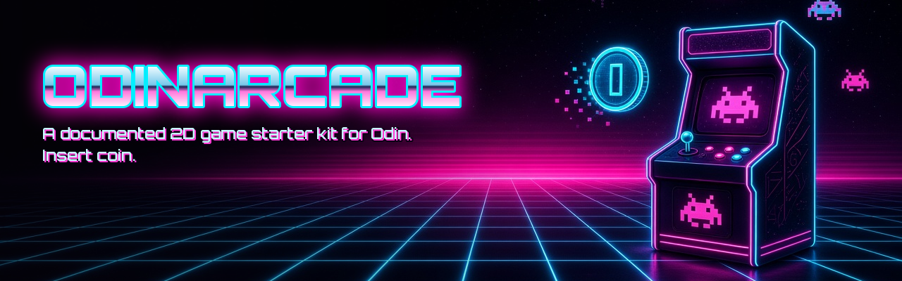

<p align="center"></p>

# Odinarcade

> ░▒▓ **a neon-lit 2D ECS starter kit for the Odin language** ▓▒░
>
> Entities on the grid. Components in tight parallel arrays. Systems sweeping
> through memory like a laser scanline at 3 a.m. No engine, no magic,
> just data riding the cache line into the sunset.

---

## Transmission note

Built and tested with **Odin dev-2026-10** (`odin build cli` + `odin test tests`
on Linux). CI also installs a real Odin release and runs the same build and
tests on Linux and macOS.

---

## What's in the cassette

| Path | What it does |
| --- | --- |
| `meta/meta.odin` | `PROJECT_NAME`, `VERSION`, `TAGLINE`: the single source of truth for project identity |
| `ecs/ecs.odin` | Core types: `Entity` (generational handle), `Vec2`, `Component`, `Component_Set` (bit_set mask) |
| `ecs/world.odin` | `World` with **SoA** component storage, entity create/destroy/recycle, component set/get/remove |
| `ecs/systems.odin` | `velocity_system` (v += a·dt), `movement_system` (p += v·dt), `world_step` |
| `color/` | The **only** module that emits ANSI codes: cyan/magenta on black |
| `cli/main.odin` | Tiny CLI: `demo`, `version`, `help` |
| `tests/` | `core:testing` suites for the ECS and the color-off behavior |

### The model, in one breath

- **Entity** = `{index, generation}`. Destroying an entity bumps its slot's
  generation, so stale handles stop resolving even after the slot is reused.
  Generations start at 1, so `NULL_ENTITY` (the zero value) is never alive.
- **Components** live in **Structure-of-Arrays** form: `positions`,
  `velocities`, `accelerations` are each a `[MAX_ENTITIES]Vec2`, indexed by
  `Entity.index`.
- **Masks**: every slot has a `bit_set[Component]`. A system runs on an entity
  when `required <= mask` (subset test).
- **Systems** are plain procs doing linear sweeps. No virtual dispatch, no
  hidden allocation.
- **World** is fixed-capacity (`MAX_ENTITIES = 1024`) and created with a single
  heap allocation via `world_create`.

```odin
import "ecs"

w := ecs.world_create()
defer ecs.world_destroy(w)

e, ok := ecs.create_entity(w)
ecs.set_position(w, e, {0, 0})
ecs.set_velocity(w, e, {1, 0.5})

ecs.world_step(w, 1.0 / 60.0)

p, _ := ecs.get_position(w, e)
```

### Adding a component

1. Add a variant to `Component` in `ecs/ecs.odin`.
2. Add a `[MAX_ENTITIES]YourType` array to `World` in `ecs/world.odin`.
3. Add `set_*` / `get_*` procs next to the others.
4. Write a system that checks `required <= w.masks[i]`.

---

## Usage

```sh
mkdir -p build
odin build cli -out:build/odinarcade
./build/odinarcade   # same as `demo`
./build/odinarcade demo
./build/odinarcade --version
./build/odinarcade --help
```

Demo output (abridged; colors stripped):

```
░▒▓ ODINARCADE ▓▒░
a neon-lit 2D ECS starter kit
-- tick 0 --
  drifter  (0.00, 0.00)
  rocket   (0.00, 0.00)
  statue   (5.00, 5.00)
...
-- tick 4 --
  drifter  (2.00, 1.00)
  rocket   (0.00, 5.00)
  statue   (5.00, 5.00)
```

### Color

Output glows **cyan** and **magenta** on black. Color switches off when:

- `NO_COLOR` is set to any non-empty value ([no-color.org](https://no-color.org)), or
- stdout is not a TTY (pipes, files, CI logs).

On Windows color is currently always off (`color/tty_windows.odin`); PRs to add a
console-mode check are welcome.

---

## Development

Requirements: a recent [Odin](https://odin-lang.org) release (the code uses the
`#+build` file-tag syntax and `core:sys/posix`).

```sh
odin test tests                             # run all tests
mkdir -p build && odin build cli -out:build/odinarcade
odin build cli -out:build/odinarcade -vet  # stricter checks (optional)
```

CI (`.github/workflows/ci.yml`) installs the latest Odin release via
`laytan/setup-odin`, builds the CLI, runs `odin test tests`, and smoke-tests
that no ANSI escapes leak into piped or `NO_COLOR` output.

### Renaming

The name is a placeholder. In code it lives in exactly one constant,
`meta.PROJECT_NAME`. Everywhere else it appears is listed in
[`RENAME.md`](RENAME.md).

---

## License

MIT. See [LICENSE](LICENSE). Now go build something that glows.
